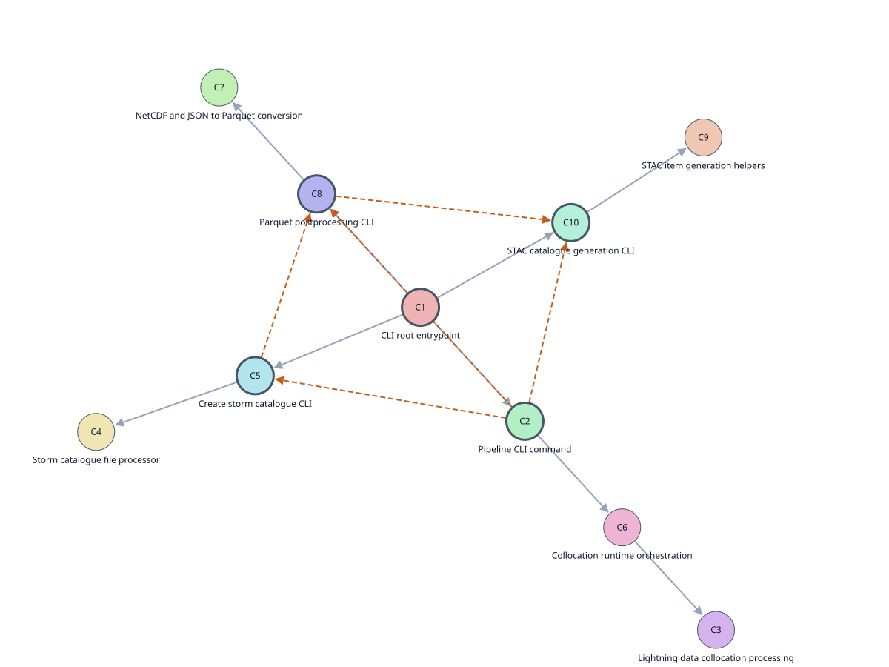

# Lightning2EarthCARE - D120 contribution

Lightning2EarthCARE combines EarthCARE observations with satellite lightning measurements. Its four CWL steps collocate observations in space and time, generate a storm catalogue, export GeoParquet tables and assemble a STAC catalogue. We contribute this [workflow](../../package.cwl) as a scientific example for OSPD 2026.

## Part A - Main report sections

### Lampata - Workflow provenance and process metadata

**Deliverable(s):** D120 - OGC API Processes Profiler; D001 report contribution.

#### Overview

We contribute the [Lightning2EarthCARE CWL application package](../../package.cwl) and a worked example showing how to describe its execution using the consortium's process and provenance profiles. The example contains a [process description](../process.json), [results metadata](../results.json) and [provenance](../provenance.jsonld) recording four executed commands and six data dependencies, preserving the original run identifiers. We also provide a [small script for extracting CWLProv records](../export_provenance.py), [five proposed activity terms](../registry/geoprocessing-activities.jsonld) and comparisons with existing registry definitions. Our findings explain where existing terms are difficult to reuse and propose a hierarchy that connects broad processing categories to more specific scientific operations.

#### Challenges

We independently encountered the mapping between CWLProv output and the consortium's provenance representation. CWLProv already uses PROV-O, but its JSON-LD structure differs from the profile. A [small helper](../export_provenance.py) extracts recorded activities, entities, roles, parameters and timestamps and attaches [scientific annotations](../annotations.ttl); profile-specific formatting remains necessary. The shared records retain the original run identifiers. Two integration gaps remain: CWL Directory inputs and outputs need a service-level representation, and the input STAC records provide product identifiers, catalogue links and DOIs but no upstream execution provenance. The current process and results documents describe a local run; they are not responses captured from an OGC API - Processes service.

#### Future work

Validate the complete provenance graph with the consortium, including the four process runs, six artifact connections and output-to-provenance links. Agree Directory/STAC handling and confirm how a consortium service would expose these records. Package the example with its schema references, JSON-LD context and validation results using [OGC Building Blocks](https://ogcincubator.github.io/bblocks-docs/). Earlier schema-subsetting work extracted required and conditional fields and selected relevant optional fields from referenced schemas. It provides a starting point for generating profile documentation containing field definitions, requirements, dependencies and worked examples. Validation would still use the complete published schemas; automated documentation and profile publication remain outstanding.

#### Figure

Figure 1. Inputs and artifact bindings from the executed CWL; catalogue counts from the actual STAC output.

### Lampata - Process typing and AI-supported descriptions

**Deliverable(s):** D120 - OGC API Processes Profiler; D001 report contribution.

#### Challenges

The existing terms have different scopes and levels of detail. Data Acquisition concerns retrieval into an indexing pipeline; Filter geometries concerns geometric objects; Field Normalization concerns individual fields. These cover parts of our operations, so the registry records related matches rather than equivalence. Within the collocation command, source selection and observation matching are distinct scientific activities, while its command-line wrapper is an implementation detail. This distinction matters for AI: a command-level label can conceal useful operations, and a label for every function can obscure their combined purpose. Broader/narrower types could support reuse at both levels, for example **Data transformation → Tabular conversion → Geospatial tabular conversion**. The hierarchy would classify operations without changing executable workflow boundaries.

| Candidate activity | Existing related term | Remaining gap |
| --- | --- | --- |
| Spatiotemporal observation collocation | [GA047 Data Acquisition](https://github.com/Kurrawong/ospd-data/blob/main/resources/registers/voyager/items/GA047.ttl) | Acquisition covers retrieval, not spatial and temporal matching between sensors. |
| Storm property summarisation | No suitable match identified | Storm properties and along-track observation statistics. |
| Spatiotemporal observation selection | [GA020 Filter geometries](https://github.com/Kurrawong/ospd-data/blob/main/resources/registers/52north/items/GA020.ttl) | Geometry filtering does not cover catalogue queries and observation-source selection. |
| Geospatial tabular conversion | [GA044 Field Normalization](https://github.com/Kurrawong/ospd-data/blob/main/resources/registers/voyager/items/GA044.ttl) | Field normalisation does not cover scientific-dataset conversion into geospatial tables. |
| STAC item generation | No suitable match identified | Metadata extraction and asset-linked STAC record creation. |

#### Future work

Enter all five candidates and their existing mappings into the registry contribution spreadsheet for review, with definitions, input/output scope, proposed parents and reuse decisions. Reuse accepted terms wherever their definitions fit, and propose additions only for confirmed gaps. Extend [gen-ogc-apppackage](https://github.com/sunnydean/gen-ogc-apppackage) to search the register, follow broader/narrower links and compare retrieved definitions with source-code and I/O evidence before assigning term identifiers. Retain the matching rationale and unresolved cases for review. Evaluate whether this improves term selection and scientific explanations against human-reviewed mappings; the benefit of hierarchical typing remains a working hypothesis.

#### Figure

Figure 2. Original notebook result: ten labelled groups, with grey code connections and orange inferred artifact links. [Interactive version](../clusters/labelled-clusters.html).
