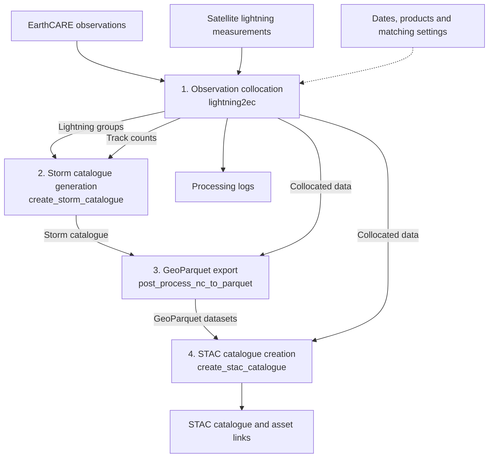

# Lightning2EarthCARE - D120 contribution

## Part A - Main Report section

### Lampata

Deliverable(s): D120 - OGC API Processes Profiler; D001.

#### Overview

[Lightning2EarthCARE](http://doi.org/10.83395/2wem-kz55) is a workflow for collocating EarthCARE satellite observations with lightning detections from geostationary sensors. It queries EarthCARE MSI and CPR data, retrieves lightning observations from MTG-LI and GOES-GLM, and performs spatial–temporal matching between the datasets. The pipeline clusters lightning detections, generates collocated datasets, and produces a catalogue of lightning storms sampled along the EarthCARE nadir track.

Its scientific inputs include EarthCARE observations and MTG-LI or GOES-GLM lightning detections, selected by dates, products, platforms and matching thresholds.

The [CWL package](https://github.com/sunnydean/lightning2earthcare/blob/ogc-ospd26/cwl/package.cwl) has four executable steps: collocation, storm catalogue generation, GeoParquet export and STAC catalogue creation. These produce matched datasets, storm summaries and geospatial features, with STAC records describing and linking the data assets.

Figure 1. Scientific inputs and six artifact bindings between four executable CWL steps.

We produced an annotated four-step CWL workflow, ten activity descriptions, [five provisional registry definitions](https://github.com/sunnydean/lightning2earthcare/blob/ogc-ospd26/cwl/ospd2026/registry/geoprocessing-activities.jsonld) and provenance metadata for Lightning2EarthCARE. The provenance was derived from `cwltool --provenance` output using the [shared PROV JSON-LD representation](https://ogcincubator.github.io/bblock-prov-schema/build/annotated/ogc-utils/prov/context.jsonld).

We used a novel AI workflow-generation approach building on our OSPD25 work. The [gen-ogc-apppackage tool](https://github.com/sunnydean/gen-ogc-apppackage) combines function clustering, I/O analysis and AI interpretation to derive descriptions from the source code. We used these groups to define the terms and map them to the register.

We wanted readers and tools to see the scientific operations performed within each command while preserving the four executable CWL steps. We therefore added structured descriptions through [CWL metadata extensions](https://www.commonwl.org/v1.2/Workflow.html#Extensions_and_metadata), which permit namespaced annotations and recommend Schema.org terms.

In our CWL, Schema.org [`s:hasPart`](https://schema.org/hasPart) attaches a list of internal activity descriptions to the relevant `CommandLineTool` or `Workflow` definition. Each entry carries an `s:identifier`, `s:name` and short `s:description`; the five scientific activities also use [`s:additionalType`](https://schema.org/additionalType) to link to their provisional registry terms. For example, `lightning2ec` contains descriptions of satellite observation discovery and multi-sensor observation matching, alongside its CLI wrapper. These entries document the command's internal structure; they do not define execution order, additional CWL steps or separately observed runs.

| Group | Activity | Description |
| --- | --- | --- |
| C1 | Workflow command entrypoint | Dispatch the selected collocation, catalogue or export command. |
| C2 | Collocation pipeline command | Configure dates, sensors and matching thresholds, then launch collocation. |
| C3 | Multi-sensor lightning matching | Cluster lightning with DBSCAN, correct MTG-LI parallax, and match EarthCARE observations in space and time. |
| C4 | Lightning storm characterisation | Derive storm area, duration, displacement and lightning activity near the radar track. |
| C5 | Storm catalogue aggregation command | Combine storm records across overpasses into an annotated JSON catalogue. |
| C6 | Satellite observation discovery and source selection | Pair EarthCARE products and select lightning sources by coverage and acquisition time. |
| C7 | Geospatial feature and time-series construction | Convert observations and storm histories into geographic point features and time-series tables. |
| C8 | GeoParquet export command | Export GeoParquet tables, grouping lightning observations by sensor and month. |
| C9 | STAC dataset item generation | Create STAC Items with spatial and temporal coverage, variable descriptions and asset links. |
| C10 | STAC catalogue assembly command | Assemble linked STAC collections for lightning observations, radar counts and storm properties. |

#### Figure

Figure 2. Function groups and inferred dependencies used to propose activity types.

We applied the [shared PROV JSON-LD representation](https://ogcincubator.github.io/bblock-prov-schema/build/annotated/ogc-utils/prov/context.jsonld) to the Lightning2EarthCARE example, linking result entities to their generating activities and execution provenance. CWLProv supplied the recorded evidence. Our initial approach was a one-to-one mapping from `cwltool --provenance` output to the shared representation. We independently developed a small helper to extract the run and data relationships and attach our activity annotations.

#### Challenges

CWLProv already uses PROV-O, making a direct mapping a reasonable first approach. Completing that mapping requires decisions about how the execution graph is represented and supplemented:

- Preserve execution relationships. Input/output roles and timestamps are attached to usage and generation records; directories and collections contain linked entities. These connections must survive the export so that the data flow remains traceable.
- Connect results to provenance. Output records need explicit provenance links and consistent identifiers, with a clear base for resolving bundle-relative references.
- Separate recorded execution from scientific interpretation. CWLProv records the four command executions, but does not supply our scientific activity terms or observe the ten internal groups as separate runs. Those descriptions remain annotations rather than additional execution records.

Our initial approach was to write a helper that transforms the CWL provenance run results to the OSPD schema but there are various challanges to a simple translation. Our helper provides a partial export. A complete mapping needs checks of identifiers and relationships alongside schema validation; changing the JSON-LD context alone does not supply the result wrappers or scientific annotations.

Another challenge we encountered was finding registered terms that adequately describe our scientific activities. For example, we identified three related terms whose definitions cover only part of the operation:

| Activity | Related registered term | Scope requiring further description |
| --- | --- | --- |
| Multi-sensor observation matching | [GA047 Data Acquisition](https://github.com/Kurrawong/ospd-data/blob/main/resources/registers/voyager/items/GA047.ttl) | The registered definition concerns connector-side retrieval, decoding and geolocation; collocation additionally associates observations in space and time. |
| Satellite observation discovery | [GA020 Filter geometries](https://github.com/Kurrawong/ospd-data/blob/main/resources/registers/52north/items/GA020.ttl) | Time, product and sensor selection extend beyond filtering a list of geometries. |
| Geospatial feature construction | [GA044 Field Normalization](https://github.com/Kurrawong/ospd-data/blob/main/resources/registers/voyager/items/GA044.ttl) | Constructing geometries from observation coordinates extends beyond normalising attributes to a common schema. |

These registered terms are imperfect matches, but they describe related families of scientific processing. We therefore propose organising existing terms and our candidate definitions within a hierarchy of broader activities and more specific operations. Shared parent terms would make related workflows easier for people to understand and compare, while preserving the distinctions between their methods. Our five definitions remain proposals for review within that structure.

The same hierarchy would give AI agents a choice of granularity when reading or generating workflows: broad activity types for summarising a workflow, and specific types for describing its scientific operations. In our example, the ten code groups include both scientific operations and command-line wrappers within four executable steps. This distinction needs to remain explicit so that a more detailed description does not imply additional executable steps.

#### Future work

We propose reviewing the CWLProv mapping and provenance links with the OSPD team. We would extend `gen-ogc-apppackage` to select activity types using registry hierarchies and code/I/O evidence. Candidate terms and proposed parents would be added to the registry spreadsheet, prioritising reuse. Optional work would build on schema subsetting to support Building Block profile documentation and publication.

